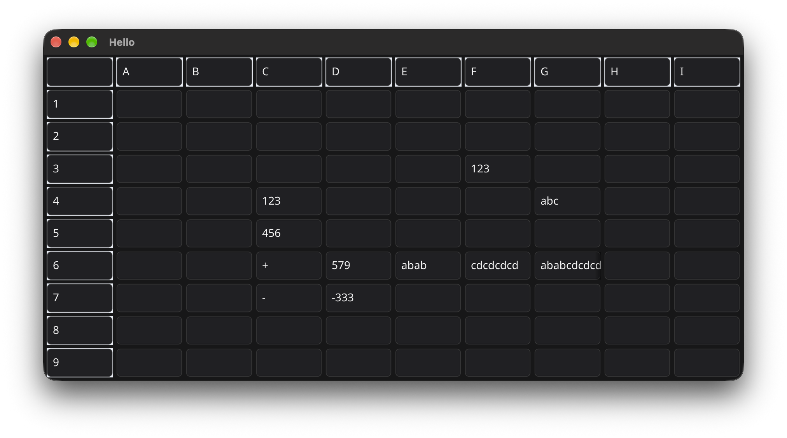

# fyne-ai
demo app vibe coded using Go / Fyne

A Fyne spreadsheet-like grid with row/column headers, arrow-key navigation, and SQLite persistence.
By default it has 16 columns and 16 rows, including the headers. Set the dimensions at startup with
`go run . -cols 15 -rows 10` (2-27 columns and at least 2 rows). Columns are labeled A-Z; data is
kept in `grid.sqlite` when changing dimensions. Older databases are migrated to consistently named
`col_N` storage columns at startup.
Cells support `=` references (for example `=B4`) and `+ / -` formulas for integer add/sub or string concatenation, with `#REF!` shown for invalid mixed-type references.

