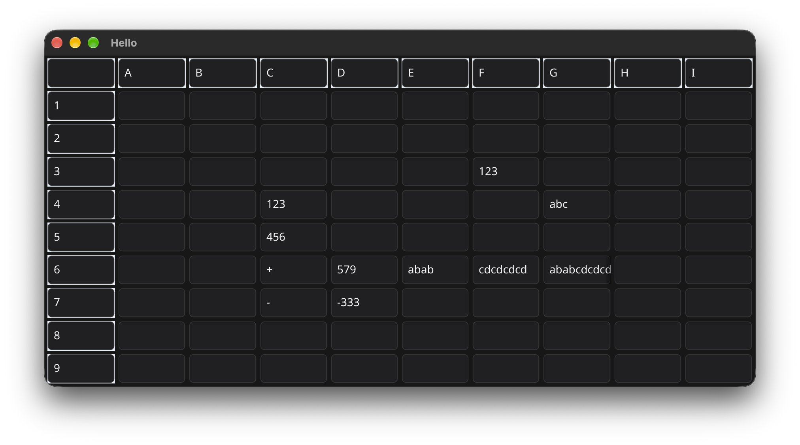

# fyne-ai
demo app vibe coded using Go / Fyne

A 10x10 Fyne spreadsheet-like grid with row/column headers, arrow-key navigation, and SQLite persistence.
Cells support `=` references (for example `=B4`) and `+ / -` formulas for integer add/sub or string concatenation, with `#REF!` shown for invalid mixed-type references.

